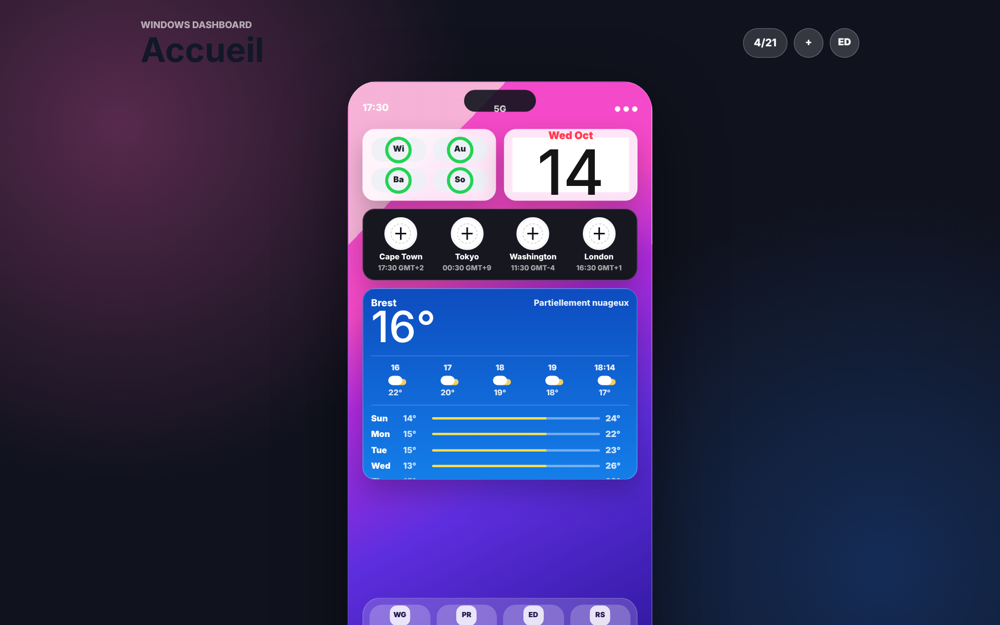
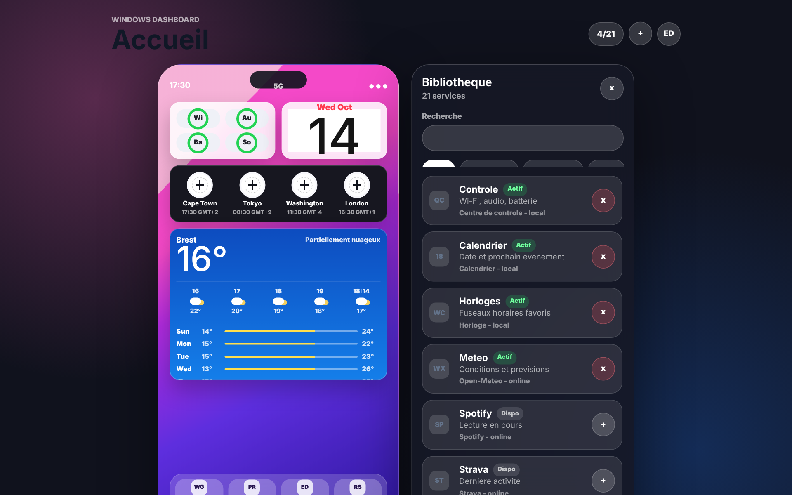

# Windows Dashboard

Application de bureau Windows qui affiche des widgets personnalisables, à la manière d'un écran d'accueil de smartphone. Elle est construite avec **Tauri v2** (Rust), **React 19** et **TypeScript**.



## Fonctionnalités

- **Gestion complète des widgets** : ajout et masquage depuis une bibliothèque de 21 services, avec catégories et recherche. On peut aussi les réordonner (glisser-déposer ou boutons clavier) et choisir leur taille (`small`, `medium`, `large`).
- **Persistance de la disposition** dans `localStorage`. Au chargement, la configuration sauvegardée est fusionnée avec les valeurs par défaut : un widget ajouté dans une nouvelle version apparaît sans écraser les réglages de l'utilisateur.
- **Météo en direct** via l'API [Open-Meteo](https://open-meteo.com/) (sans clé) : température, vent et conditions, avec gestion des erreurs réseau.
- **Horloges mondiales** basées sur les fuseaux IANA (`Intl.DateTimeFormat`) : l'heure d'été est prise en compte automatiquement.
- **Accessibilité** : chaque action (ajout, déplacement, redimensionnement) est annoncée via une région `aria-live`, et tous les contrôles ont un libellé.
- **Fenêtre native** transparente, hors barre des tâches.



## Statut

Prototype. Le gestionnaire de widgets, la météo actuelle et les horloges sont fonctionnels. Les autres widgets (Spotify, Strava, Obsidian, Gmail…) affichent pour l'instant des **données d'exemple**, tout comme les prévisions horaires et journalières. Les services correspondants (`src/services/*Service.ts`) sont prévus mais pas encore implémentés.

## Architecture

```text
src/
|- App.tsx                 # État global : liste des widgets, mode édition, bibliothèque
|- components/
|  |- Dashboard.tsx        # Grille, glisser-déposer, barre d'actions
|  |- WidgetLibrary.tsx    # Catalogue filtrable (catégorie + recherche)
|  `- widgets/
|     |- widgetRegistry.tsx  # type de widget -> composant de rendu
|     `- WeatherWidget.tsx
|- data/widgetConfig.ts    # Catalogue et disposition par défaut
|- services/
|  |- weatherService.ts    # Client Open-Meteo
|  `- widgetStorage.ts     # Sauvegarde, fusion avec les valeurs par défaut, réinitialisation
`- types/                  # Types du domaine (WidgetModule, WidgetSize, ...)
src-tauri/                 # Hôte natif Tauri v2 (configuration de la fenêtre, empaquetage)
```

Ajouter un widget revient à déclarer une entrée dans `widgetConfig.ts` et, si besoin, un composant dans `widgetRegistry.tsx`.

## Lancer le projet

Prérequis : Node.js 20+, la toolchain Rust (`rustup`) et les [prérequis Tauri pour Windows](https://v2.tauri.app/start/prerequisites/) (WebView2, MSVC Build Tools).

```powershell
npm install
npm run tauri dev      # application de bureau avec rechargement à chaud
npm run tauri build    # installeur Windows dans src-tauri/target/release/bundle
```

Pour travailler uniquement sur l'interface dans un navigateur : `npm run dev`, puis ouvrir http://localhost:1420.

## Licence

[MIT](LICENSE)
